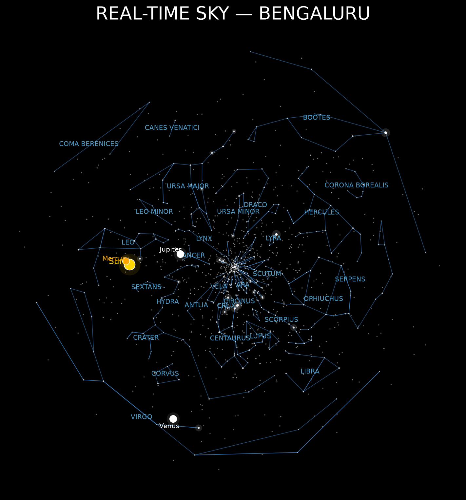

# REALTIME_SKYMAP

**Real-Time Sky Map Generator**: a Stellarium-style sky map built in Python.

REALTIME_SKYMAP computes where stars, constellations and Solar System bodies appear in the sky for an observer's location and time, and renders the result as a labelled map image. The included sample shows the sky over Bengaluru with constellation lines and names, background stars, and the Sun, Mercury, Venus and Jupiter.



---

## Features

- **Observer-based sky positions.** Celestial coordinates are converted to the observer's local sky using Astropy's `EarthLocation`, `AltAz` and `Time`.
- **Constellations.** Constellation lines and name labels drawn from the data in `data/constellations.json` and `data/constellations.csv`.
- **Star field.** Background stars from the Hipparcos catalogue (`data/hip_catalogue.csv`), with visual magnitude (`Vmag`) and colour index (`B-V`) available for each star.
- **Named bright stars.** A bright-star table (`data/stars_real.csv`) with catalogue number, name, right ascension, declination and magnitude.
- **Solar System bodies.** The Sun and planets are labelled on the map (Sun, Mercury, Venus and Jupiter in the sample output).
- **Data download scripts.** Separate scripts fetch the catalogue data, so the datasets can be rebuilt from source.
- **Image output.** Each map is saved as a PNG in the `output/` folder.

## Project structure

```
REALTIME_SKYMAP/
├── data/
│   ├── catalogue/
│   │   └── catalog.gz            # downloaded raw catalogue
│   ├── constellations.csv        # constellation definitions (table form)
│   ├── constellations.json       # constellation definitions (JSON form)
│   ├── hip_catalogue.csv         # Hipparcos stars: HIP, RAICRS, DEICRS, Vmag, B-V
│   ├── stars_real.csv            # bright named stars: hr, name, ra, dec, magnitude
│   └── stars.csv                 # star list used by the star plotting scripts
├── output/
│   ├── realtime_sky.png          # real-time sky map
│   └── constellation_test.png    # constellation map test render
└── src/
    ├── config.py                 # shared project settings
    ├── constellation_engine.py   # constellation data processing and sky-coordinate conversion
    ├── constellation_map.py      # constellation map script
    ├── download_catalogue.py     # downloads the star catalogue
    ├── download_hip_catalogue.py # downloads the Hipparcos catalogue
    ├── multi_star_map.py         # multi-star map script
    ├── realtime_sky.py           # real-time sky map script
    └── stars.py                  # star data and plotting helpers
```

## Data

| File | Columns | Description |
|---|---|---|
| `data/hip_catalogue.csv` | `HIP`, `RAICRS`, `DEICRS`, `Vmag`, `B-V` | Hipparcos stars: identifier, right ascension and declination in degrees (ICRS), visual magnitude, colour index |
| `data/stars_real.csv` | `hr`, `name`, `ra`, `dec`, `magnitude` | Bright named stars: HR catalogue number, designation (for example `9Alp CMa`), right ascension in hours, declination in degrees, magnitude |
| `data/constellations.csv` / `.json` | not applicable | Constellation definitions used to draw the lines and labels |

## Tech stack

- **Python 3.14**
- **Astropy**: coordinates, time and units (`SkyCoord`, `EarthLocation`, `AltAz`, `Time`)
- **NumPy** and **pandas**: catalogue handling and numerical work
- **Matplotlib**: rendering the map
- **Astroquery**, **Requests**, **Beautiful Soup**: fetching catalogue data
- **SciPy** and **Pillow**: supporting numerical and image work

## Getting started

**1. Clone the repository**

```bash
git clone https://github.com/Vennelam1730/REALTIME_STARMAP.git
cd REALTIME_STARMAP
```

**2. Create and activate a virtual environment** (Windows PowerShell)

```powershell
python -m venv .venv
.venv\Scripts\Activate.ps1
```

On macOS or Linux, activate with `source .venv/bin/activate` instead.

**3. Install the dependencies**

```bash
pip install -r requirements.txt
```

## Usage

**Download the catalogue data** (only needed if the `data/` folder is empty):

```bash
python src/download_catalogue.py
python src/download_hip_catalogue.py
```

**Generate the real-time sky map:**

```bash
python src/realtime_sky.py
```

The map is saved to `output/realtime_sky.png`.

**Other maps:**

```bash
python src/constellation_map.py
python src/multi_star_map.py
```

## How it works

1. **Load the catalogues.** Star positions (right ascension and declination, ICRS) and magnitudes are read from the CSV files in `data/` with pandas.
2. **Set the observer and time.** An Astropy `EarthLocation` for the observer and a `Time` for the current moment define the sky to compute.
3. **Convert coordinates.** Each position is turned into a `SkyCoord` and transformed into the observer's local altitude-azimuth (`AltAz`) frame.
4. **Add constellations and bodies.** Constellation lines and labels come from the constellation data, and Solar System bodies are placed on the same sky.
5. **Render.** Matplotlib draws the stars, scaled by magnitude, with constellation lines, labels and a title, then saves the image to `output/`.

## Author

**Vennela M**
B.Tech Aerospace Engineering
GitHub: [@Vennelam1730](https://github.com/Vennelam1730)
